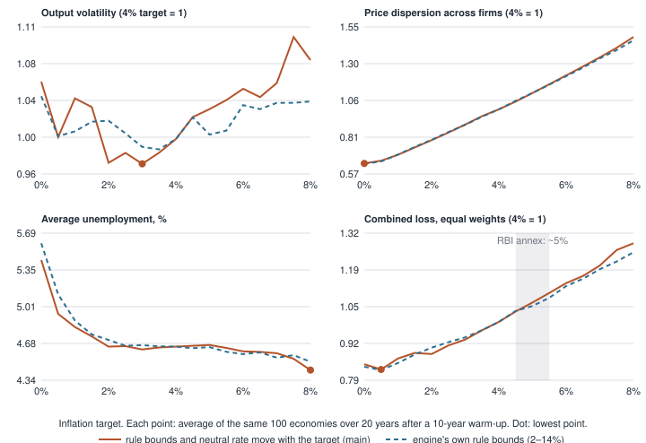

# What inflation target suits India? Rerunning the RBI's experiment

In its *Report on Currency and Finance 2020-21* (Chapter II, Annex II.2), the RBI ran a stylised agent-based model, Mark-0 by Gualdi et al. (2017), with inflation targets from 0% to 8%.
- **Output loss:** high below 3.5% and above 4.5%.
- **Price dispersion across firms:** rose with the target, sharply above 5%.
- **Combined loss** (equal weights on the two): lowest at about 5%.

The RBI used this to support keeping the 4% ± 2% target. Unlike Mark-0, Economy Lab is calibrated to Indian data, so this folder reruns the same exercise in it.



## Set-up

- **Targets:** 17, from 0% to 8% in steps of 0.5 points.
- **Economies:** the same 100 economies (seeds 1–100) at every target, so differences come from the target, not luck.
- **Timing:** a 10-year warm-up, then 20 years measured. The target applies from the start, and the random harvest, oil, demand and capital-flow shocks are on.
- **Policy:** the RBI rule as calibrated (same reaction, smoothing and 50-basis-point steps).
  - **Main version:** the neutral repo rate, the rule's bounds and the moneylender rate all move one-for-one with the target. Only the nominal anchor changes, and the repo rate can't go below 0%.
  - **Check:** the engine's own fixed rule bounds (repo 2–14%).
  - At a 4% target the two are identical to the standard engine.
- **Measures:**
  - output volatility: variance of log output;
  - price dispersion: within-sector spread of log prices across firms, weighted by CPI shares;
  - average unemployment and output level;
  - the RBI's combined loss: each measure scaled so that 4% = 1, weighted equally.

All 3,400 runs kept their accounts balanced.

## Results

| Target | Inflation achieved | Output volatility | Price dispersion | Unemployment | Output level vs 4% | Months at 0% repo | Combined loss |
|---|---|---|---|---|---|---|---|
| 0% | −0.6% | 1.06 | 0.64 | 5.45% | −0.74% | 25% | 0.85 |
| 1% | 0.7% | 1.04 | 0.70 | 4.83% | −0.11% | 13% | 0.87 |
| 2% | 1.8% | 0.98 | 0.79 | 4.65% | +0.06% | 9% | 0.89 |
| 3% | 2.8% | **0.98** | 0.90 | 4.62% | +0.06% | 0 | 0.94 |
| 4% | 3.7% | 1.00 | 1.00 | 4.65% | 0 | 0 | 1.00 |
| 5% | 4.7% | 1.03 | 1.11 | 4.66% | −0.03% | 0 | 1.07 |
| 6% | 5.8% | 1.05 | 1.23 | 4.60% | 0.00% | 0 | 1.14 |
| 8% | 8.0% | 1.08 | 1.48 | 4.43% | +0.15% | 0 | 1.28 |

The table shows the main version. The full table and the check version are in `result.json`. The check version gives the same picture.

**Where Economy Lab agrees with the RBI:**
1. **Very low targets are costly.** At a 0% target, unemployment averages 0.8 points higher than at 4%, and output is 0.7% lower (t = 6.4 and 5.5 across the 100 paired economies). The causes are prices and wages that fall more slowly than they rise, and a repo rate stuck at 0% in a quarter of months. At 1% the costs are already small.
2. **Output is steadiest around 3–3.5%.** Volatility is lowest at 3%. It is significantly higher at 6% (t = 2.5) and 8% (t = 2.6), but only weakly higher at 0% (t = 1.3). This is the same U-shape as the RBI's output-loss curve, with the bottom about one point lower.
3. **Price dispersion rises with the target.** Higher targets mean prices drift further between firms' price reviews. This is very precisely estimated (t > 20).

**Where it disagrees:**
- **The combined loss is lowest at 0.5%, not 5%.** Price dispersion rises steeply and steadily from 0%; the RBI found it rising sharply only above 5%. Economy Lab's output costs at low targets, by contrast, are mild above 1%. With equal weights, dispersion therefore dominates.
- **No weighting of these two measures can put the optimum at 5%.** Dispersion only rises with the target, and output volatility bottoms out at 3–3.5%. So the combined loss always bottoms out somewhere between 0% and 3.5%.
- **Resampling the 100 economies** (bootstrap) puts the combined-loss minimum between 0% and 0.5% every time.

## How to read this

- **Economy Lab supports a target around 3–4%, not one above 4%,** if steady output is what matters. It sees large costs only below about 1–1.5%, much lower than Mark-0's 3.5%.
- **The 5% result does not carry over to a model calibrated to India.** It appears to come from Mark-0's own settings and from how price dispersion is measured.
- **Model details drive the low-inflation costs.** These come from how fast prices and wages fall (`priceCut`, wage indexation) and from the 0% floor on the repo rate. A paper should test these, for example by adding `priceCut: 0.2` or `0.8` to `params` in `sweep.js` and rerunning.
- **The equal-weight loss is the RBI's choice, not a welfare measure.** Price dispersion is in different units from output volatility. Scaling both to "4% = 1" makes the answer depend on how much each measure moves.
- **Inflation runs about 0.3 points below each target.** This happens at every target in this calibration, so it doesn't affect the comparison.

## Rerunning

```bash
./run.sh            # about 1 minute on 8 cores; writes runs/, result.json and chart.svg
node sweep.js 0.03 1 10 20 shift   # one target (3%), economies 1–10, 20 years
```
